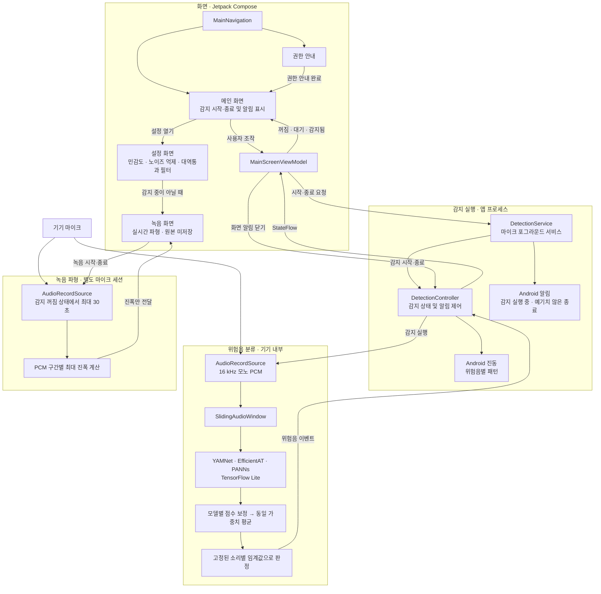

# EarView 아키텍처 구조도

EarView는 주변 소리를 기기 안에서 분류해 화면과 진동으로 알리는 Android 앱이다. 아래 구조도는 현재 코드에서 연결된 경로를 보여 준다.

- **감지 흐름:** [EarViewApplication](../app/src/main/java/com/example/earview/EarViewApplication.kt)이 공유 컨트롤러를 만들고, [DetectionService](../app/src/main/java/com/example/earview/detection/DetectionService.kt)가 사용자의 시작·종료 요청을 전달한다. [YamnetSoundDetector](../app/src/main/java/com/example/earview/detection/YamnetSoundDetector.kt)는 앙상블 점수를 소리별 임계값과 비교한다.
- **화면과 알림:** 메인 화면 하단에는 화재경보, 사이렌, 유리 깨짐, 차량 경적을 표시한다. 분류 대상은 여전히 초인종과 문 두드림을 포함한 6종이다. 감지되면 [DetectionController](../app/src/main/java/com/example/earview/detection/DetectionController.kt)가 화면 상태와 진동을 갱신한다. 화면 알림은 탭하거나 10초가 지나면 대기 상태로 돌아간다.
- **설정과 녹음:** [설정 화면](../app/src/main/java/com/example/earview/ui/main/DetectionFeaturePreview.kt)의 민감도, 노이즈 억제, 대역통과 필터 조작은 감지 경로에 연결되지 않는다. 실시간 파형은 실제 마이크 입력에서 계산한다. 녹음 등록·보관은 구현되지 않아 녹음 관리 목록은 비어 있다.
- **데이터 경계:** 감지와 파형에 쓰는 원본 오디오는 메모리에서만 처리한다. 디스크에 쓰거나 네트워크로 보내지 않는다.
